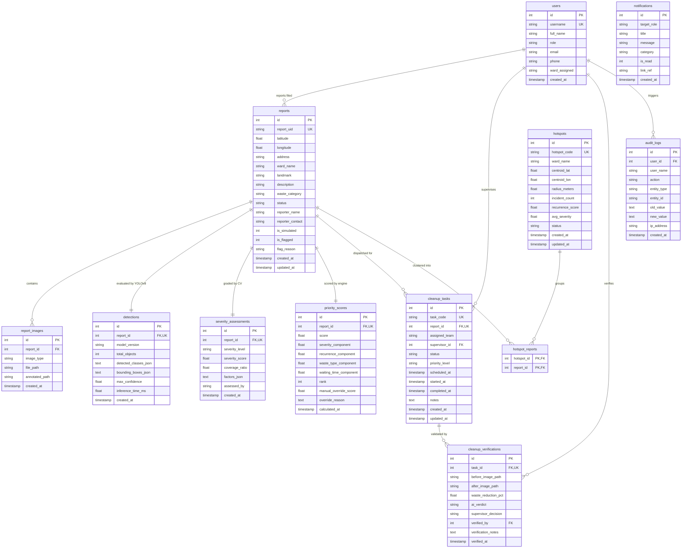

# NIRMAAN AI: Relational Database Architecture

This document specifies the SQLite relational database schema, integrity constraints, indexing strategies, and entity relationships for **NIRMAAN AI: Garbage Hotspot Prioritization**.

---

## 1. Entity-Relationship (ER) Diagram



---

## 2. Integrity & Relational Architecture Rules

1. **Foreign Key Enforcement**:  
   Every database connection is initialized with:
   ```sql
   PRAGMA foreign_keys = ON;
   PRAGMA journal_mode = WAL;
   ```
2. **Cluster vs. Hotspot Independence**:  
   DBSCAN clusters generated during spatial analysis are mapped to persistent `hotspots` using `hotspot_code` (e.g. `HS-KOR-001`), ensuring that re-clustering on incoming reports updates associations via `hotspot_reports` without destabilizing historical keys.
3. **Cascading Deletions**:  
   When an incident `reports` row is deleted, related child records (`report_images`, `detections`, `severity_assessments`, `priority_scores`, `cleanup_tasks`) are safely removed via `ON DELETE CASCADE`.
4. **Immutable Audit Trail**:  
   Every status change, task reassignment, and supervisory score override generates an append-only row in `audit_logs` capturing timestamp, actor username, old value, and new value.
5. **Future PostgreSQL / PostGIS Path**:  
   Coordinate fields `latitude` and `longitude` are standardized as decimal degrees ($WGS84$, $EPSG:4326$), facilitating frictionless migration to PostgreSQL `geometry(Point, 4326)` and PostGIS spatial indexing (`ST_DWithin`).
